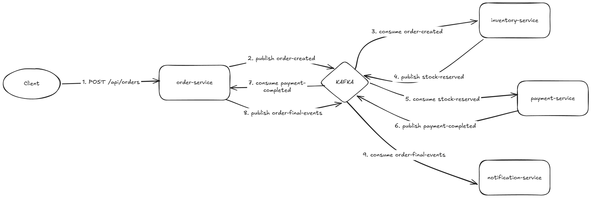

# Order Platform

An order processing system built as four Spring Boot microservices that
communicate through Kafka. A customer order flows through stock reservation,
payment, and notification. If payment fails, the reserved stock is released
back to the catalog.

## Architecture

The services don't call each other directly. Each one publishes events to
Kafka and listens to the events it cares about.

| Service | Port | What it does |
|---|---|---|
| order-service | 8081 | Creates orders and manages their status |
| inventory-service | 8082 | Manages the product catalog and stock reservations |
| payment-service | 8083 | Charges payments through a simulated gateway |
| notification-service | 8084 | Records notifications for the customer |

Each service has its own in-memory H2 database.

### Event flow



When the payment is rejected, `order-service` cancels the order and publishes
`stock-release`, which `inventory-service` consumes to put the stock back.

## Tech stack

- Java 25
- Spring Boot 4
- Apache Kafka 4 (KRaft)
- H2 in-memory database
- Maven
- Docker Compose

## Running it

Start Kafka:

```bash
docker compose up -d
```

Start the four services (one per terminal, or from your IDE):

```bash
cd order-service && mvn spring-boot:run
cd inventory-service && mvn spring-boot:run
cd payment-service && mvn spring-boot:run
cd notification-service && mvn spring-boot:run
```

Kafka UI is at http://localhost:8090

## Try it

Create an order:

```bash
curl -X POST http://localhost:8081/api/orders \
  -H "Content-Type: application/json" \
  -d '{
    "customerId": "cust-1",
    "paymentMethodToken": "pm_test_visa_ok",
    "items": [{"productId": "PROD-001", "quantity": 2}]
  }'
```

The order will go through the whole flow. You can follow the events in Kafka
UI and check the final status:

```bash
curl http://localhost:8081/api/orders/<orderId>
```

Use `pm_declined_card` as the token to see the payment failure path.